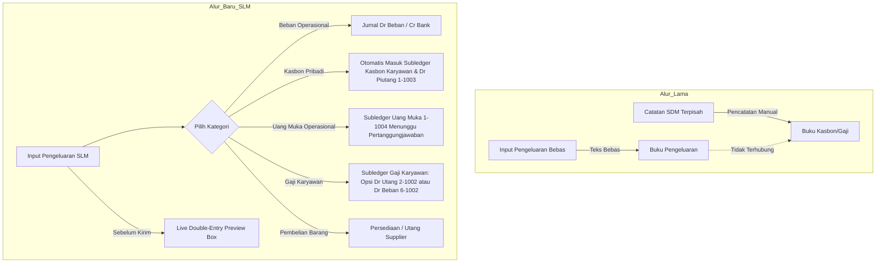
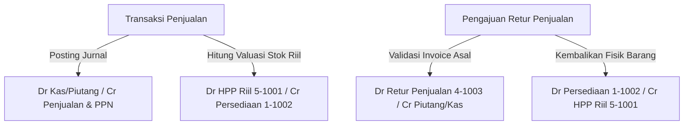

# Dokumen Serah Terima Akhir & Runbook Operasional Keuangan dan SDM
**PT Surya Logam Mulia (SLM Internal App)**  
*Dokumen Referensi Resmi Implementasi Mandat [docs/SLM-final-prompt.md](file:///Users/lrmcorporation/Documents/Website/SLM/docs/SLM-final-prompt.md)*

---

## 1. Ringkasan Eksekutif & Status Implementasi

Aplikasi internal **PT Surya Logam Mulia (SLM)** telah ditingkatkan secara menyeluruh untuk mengintegrasikan alur operasional pengeluaran harian, pengelolaan sumber daya manusia (SDM), pengadaan impor multi-valas (USD & RMB), perhitungan harga pokok penjualan (HPP) riil, serta pencatatan akuntansi berbasis **Double-Entry Equilibrium** yang terhubung langsung dengan sistem ERP Aneka Jaya.

### Status Pencapaian 5 Modul Utama

| Modul | Ruang Lingkup & Mandat | Status Verifikasi | Hasil Utama |
| :--- | :--- | :--- | :--- |
| **Tahap 1: Pengeluaran $\rightarrow$ SDM** | Form pengeluaran otomatis mengalirkan data ke Kasbon, Gaji, Uang Muka, dan Beban tanpa entri ulang. | **100% Selesai** | Live journal preview, pemisahan Utang Gaji (`2-1002`) vs Beban Gaji (`6-1002`), subledger atomik. |
| **Tahap 2: Akuntansi & Jurnal** | Sistem pembukuan berpasangan (Double-Entry), Bagan Akun Standar (COA), Neraca Saldo, Buku Besar, Tutup Buku & Reversal. | **100% Selesai** | Validasi keseimbangan otomatis, penolakan jurnal timpang, penguncian periode transaksi, reversal audit trail. |
| **Tahap 3: Pembelian Valas & Rekening** | Pengadaan barang impor USD/RMB, alokasi landed cost (freight, bea, asuransi, handling), rekening bank per mata uang fisik. | **100% Selesai** | Kalkulator landed cost proporsional nilai/qty, pencatatan kurs riil, pemisahan mutasi valas asli dan ekuivalen IDR. |
| **Tahap 4: Penjualan & HPP Riil** | Alur penjualan multi-termin (Cash, TF, Tempo, Other), pencatatan HPP berdasarkan valuasi persediaan riil, dan retur penjualan. | **100% Selesai** | Sinkronisasi invoice ERP, jurnal HPP riil non-estimasi, pembalikan retur terhubung ke invoice asli. |
| **Tahap 5: SDM Lanjutan** | Bagan struktur organisasi hierarkis serta modul Simpanan Karyawan internal (`2-1003`). | **100% Selesai** | Bagan hierarki atasan-bawahan dinamis, mutasi setoran & penarikan simpanan terhubung ke rekening kas/bank. |
| **Refinement UI/UX** | Tata letak Sidebar sticky & scrolling mandiri, normalisasi 100% class Tailwind CSS v3, peningkatan rasio kontras warna. | **100% Selesai** | Sidebar terkunci rapi pada halaman panjang, nol class v4 tidak valid, lulus audit kontras tema terang. |

---

## 2. Peta Alur Transaksi Bisnis (Lama vs Baru)

### A. Alur Pengeluaran $\rightarrow$ SDM

Sebelumnya, staf operasional mencatat pengeluaran operasional dan kasbon/gaji secara terpisah di aplikasi yang berbeda atau melalui deskripsi teks bebas (seperti *"Kasbon Pak Budi"*), yang rawan menyebabkan pencatatan ganda atau kelalaian pemotongan saldo piutang.



### B. Alur Pembelian Impor & Landed Cost


### C. Alur Penjualan, HPP Riil, dan Retur



---

## 3. Kamus Akuntansi Standar (Standard Chart of Accounts & Journal Rules)

### Matriks 14 Aturan Jurnal Minimum Sesuai Mandat

| No | Peristiwa Bisnis | Debit (Dr) | Kredit (Cr) | Ketentuan Khusus |
| :---: | :--- | :--- | :--- | :--- |
| **1** | Beban biasa dibayar | `6-xxxx` Beban Terkait | `1-1001` Kas & Bank | Menggunakan rekening sumber fisik pembayaran. |
| **2** | Kasbon dicairkan | `1-1003` Piutang Karyawan | `1-1001` Kas & Bank | Menambah saldo piutang kasbon karyawan terpilih di SDM. |
| **3** | Kasbon dilunasi via transfer/tunai | `1-1001` Kas & Bank | `1-1003` Piutang Karyawan | Mengurangi saldo kasbon terbuka orang yang bersangkutan saja. |
| **4** | Kasbon dipotong dari gaji terutang | `2-1002` Utang Gaji | `1-1003` Piutang Karyawan | Tidak melibatkan mutasi rekening bank; memerlukan otorisasi tertulis. |
| **5** | Uang muka operasional dicairkan | `1-1004` Uang Muka Karyawan | `1-1001` Kas & Bank | Terpisah dari kasbon pribadi; menunggu form pertanggungjawaban. |
| **6** | Uang muka dipertanggungjawabkan | `6-xxxx` Beban Riil / `1-1002` Aset & `1-1001` Kas (jika ada sisa) | `1-1004` Uang Muka Karyawan | Sisa uang kembali didebit ke kas/bank penampung. |
| **7** | Gaji dibayar (belum diakrualkan) | `6-1002` Beban Gaji Karyawan | `1-1001` Kas & Bank | Dicatat jika perusahaan menggunakan metode kas langsung. |
| **8** | Gaji dibayar (sudah diakrualkan) | `2-1002` Utang Gaji | `1-1001` Kas & Bank | Melunasi liabilitas gaji yang diakui akhir bulan sebelumnya. |
| **9** | Simpanan karyawan diterima | `1-1001` Kas & Bank atau `2-1002` Utang Gaji | `2-1003` Utang Simpanan Karyawan | Tabungan internal karyawan; bukan pendapatan perusahaan. |
| **10** | Simpanan karyawan ditarik | `2-1003` Utang Simpanan Karyawan | `1-1001` Kas & Bank | Pencairan tabungan karyawan melalui rekening perusahaan. |
| **11** | Invoice supplier disetujui | `1-1002` Persediaan / BDP & Pajak Masukan | `2-1001` Utang Usaha | Mencatat timbulnya kewajiban kepada supplier (IDR/Valas). |
| **12** | Pembayaran invoice supplier | `2-1001` Utang Usaha & `6-1006` Rugi Kurs (bila ada) | `1-1001` Kas/Bank & `4-1002` Laba Kurs (bila ada) | Mengakui selisih kurs realisasi pelunasan valas. |
| **13** | Invoice penjualan diterbitkan | `1-1001` Kas / `1-1005` Piutang Usaha | `4-1001` Penjualan Barang & PPN Keluaran | Sesuai termin pembayaran Cash, Transfer, atau Tempo. |
| **14** | Barang terjual (Pengakuan HPP) | `5-1001` Beban Pokok Penjualan (HPP) | `1-1002` Persediaan Barang | Berdasarkan nilai perolehan riil (termasuk landed cost teralokasi). |

---

## 4. Keputusan Arsitektur Data Model & Komponen

### Entitas Database Inti (Prisma Schema)

1. **`Account` (Bagan Akun COA)**:
   - Menyimpan kode akun (`code`), nama (`name`), kategori (`category`), saldo normal (`normalBalance`), dan flag `isSystem`.
2. **`JournalEntry` & `JournalLine`**:
   - Struktur ayat jurnal berpasangan. Mengunci status `POSTED` (tidak dapat diedit langsung), mencatat relasi `sourceType` & `sourceId`, serta mewajibkan $\sum \text{Debit} == \sum \text{Kredit}$.
3. **`BookkeepingPeriod`**:
   - Mengelola status buka/tutup buku bulanan/tahunan. Menolak transaksi baru pada periode dengan status `CLOSED`.
4. **`EmployeeLoan` & `EmployeeSalaryPayment`**:
   - Subledger piutang kasbon, uang muka, dan riwayat pembayaran gaji karyawan.
5. **`EmployeeSavingsAccount` & `EmployeeSavingsTransaction`**:
   - Subledger tabungan karyawan yang mencatat nomor rekening simpanan internal, akumulasi setoran, penarikan, dan saldo berjalan.
6. **`PurchaseOrder`, `PurchaseReceipt`, `SupplierInvoice`, & `LandedCostAllocation`**:
   - Manajemen rantai pasok impor multi-valas dengan alokasi biaya pengiriman dan bea masuk ke HPP tiap SKU barang.

---

## 5. Prosedur Operasional Standar (SOP) Pengguna

### SOP-01: Input Pengeluaran & Pratinjau Jurnal
1. Masuk ke menu **Pengeluaran $\rightarrow$ Input Pengeluaran**.
2. Pilih tanggal, rekening sumber dana, dan **Kategori Transaksi**:
   - Jika memilih **Gaji**, tentukan apakah pembayaran merupakan *Beban Gaji Langsung* (`6-1002`) atau *Pelunasan Utang Gaji* (`2-1002`), serta masukkan periode bulan/tahun.
   - Jika memilih **Kasbon Pribadi**, pilih nama karyawan peminjam.
   - Jika memilih **Uang Muka Operasional**, pilih penerima dan deskripsi keperluan operasional.
3. Masukkan nominal uang yang benar-benar dibayarkan.
4. Periksa kotak **Pratinjau Jurnal Otomatis** di atas tombol submit. Pastikan akun debit dan kredit sudah seimbang dan tepat.
5. Unggah bukti pembayaran dan klik **Simpan Pengeluaran**.

### SOP-02: Pelunasan Kasbon & Uang Muka
1. Masuk ke menu **SDM $\rightarrow$ Kasbon**.
2. Klik nama karyawan untuk membuka kartu subledger kasbon.
3. Klik tombol **Catat Pelunasan**:
   - Masukkan nominal (tidak boleh melebihi sisa saldo berjalan).
   - Pilih metode: *Transfer/Tunai* (menambah kas perusahaan) atau *Potong Gaji* (mengurangi utang gaji tanpa mutasi bank).
4. Untuk **Uang Muka Operasional**, gunakan tombol **Pertanggungjawaban Uang Muka** untuk mencatat biaya riil yang terjadi dan mengembalikan sisa dana ke kas.

### SOP-03: Pengelolaan Simpanan Karyawan
1. Masuk ke menu **SDM $\rightarrow$ Simpanan**.
2. Untuk menerima tabungan: Klik **+ Setor Simpanan**, pilih karyawan penyetor, masukkan nominal dan rekening penampung.
3. Untuk pencairan: Klik **− Tarik Simpanan**, pilih rekening simpanan, masukkan nominal penarikan (sistem otomatis memvalidasi batas saldo tersedia).
4. Seluruh mutasi simpanan otomatis mem-posting ayat jurnal `2-1003 Utang Simpanan Karyawan`.

### SOP-04: Tutup Buku Akhir Periode
1. Masuk ke menu **Akuntansi $\rightarrow$ Tutup Buku**.
2. Pastikan seluruh transaksi bulan terkait telah berstatus `Approved` dan `Posted`.
3. Klik tombol **Tutup Buku Periode Ini**.
4. Setelah periode dikunci, transaksi pada tanggal periode tersebut tidak dapat ditambahkan atau diedit untuk mencegah perubahan laba rugi masa lalu.

---

## 6. Rencana Backup, Rollout, dan Rollback Produksi

### A. Rencana Backup Pra-Deployment
Sebelum menerapkan rilis baru ke server produksi:
1. Jalankan snapshot backup penuh database PostgreSQL:
   ```bash
   pg_dump -U postgres -d slm_production -F c -b -v -f "/backup/slm_backup_$(date +%Y%m%d_%H%M%S).dump"
   ```
2. Pastikan file backup terverifikasi dan dapat diakses untuk prosedur pemulihan cepat.

### B. Prosedur Rollout (Deployment)
1. Tarik pembaruan kode terbaru dari repositori cabang utama (`main`).
2. Pasang dependensi dan lakukan migrasi database:
   ```bash
   npm ci
   npx prisma migrate deploy
   ```
3. Kompilasi bundle produksi:
   ```bash
   npm run build
   ```
4. Restart proses aplikasi dengan manajer proses (PM2 atau systemd):
   ```bash
   pm2 reload slm-internal-app --update-env
   ```
5. Lakukan verifikasi kesehatan sistem (*health check*):
   ```bash
   curl -f http://localhost:3000/api/health
   ```

### C. Prosedur Rollback (Bila Terjadi Kendala)
1. Jika terjadi kesalahan fatal aplikasi setelah rilis:
   ```bash
   git checkout <commit-hash-stabil-sebelumnya>
   npm ci
   npm run build
   pm2 reload slm-internal-app
   ```
2. Jika terjadi ketidaksesuaian skema database:
   ```bash
   pg_restore -U postgres -d slm_production --clean "/backup/slm_backup_<timestamp>.dump"
   ```

---

## 7. Keputusan Bisnis & Akuntansi yang Memerlukan Otorisasi Pemilik / Akuntan

Berikut adalah daftar keputusan kebijakan akuntansi yang telah disediakan infrastrukturnya di dalam kode, namun memerlukan ketetapan resmi dari pemilik perusahaan atau akuntan publik terdaftar:

1. **Kebijakan Pengakuan Beban Gaji (Akrual vs Kas):**
   - *Status Sistem:* Sistem mendukung kedua metode melalui switch `salaryPaymentType` (`EXPENSE` vs `PAYABLE`).
   - *Keputusan yang Diperlukan:* Menetapkan apakah perusahaan wajib menjalankan akrual jurnal penyesuaian gaji setiap akhir bulan, atau membebankan langsung saat tanggal pembayaran kas.
2. **Revaluasi Kurs Valas Akhir Periode (Mark-to-Market):**
   - *Status Sistem:* Saldo rekening valas USD dan RMB mencatat mata uang asli dan ekuivalen IDR berdasarkan kurs transaksi terakhir.
   - *Keputusan yang Diperlukan:* Menetapkan apakah perusahaan akan melakukan revaluasi otomatis saldo valas ke kurs tengah Bank Indonesia / JISDOR setiap akhir bulan dengan mengakui *Unrealized Forex Gain/Loss*.
3. **Kebijakan Simpanan Karyawan:**
   - *Status Sistem:* Tercatat murni sebagai kewajiban internal (`2-1003 Utang Simpanan Karyawan`) tanpa perhitungan bunga/bagi hasil.
   - *Keputusan yang Diperlukan:* Menegaskan secara tertulis dalam peraturan perusahaan bahwa tabungan karyawan adalah fasilitas internal non-bunga demi kepatuhan regulasi perbankan dan ketenagakerjaan.
4. **Perlakuan Pajak Impor (PPN Masukan & PPh Pasal 22 Impor):**
   - *Status Sistem:* Kalkulator landed cost memisahkan biaya freight, asuransi, dan bea masuk yang dikapitalisasi ke nilai persediaan barang.
   - *Keputusan yang Diperlukan:* Menetapkan apakah PPN Masukan impor dikreditkan pada SPT Masa PPN atau dikapitalisasi ke harga pokok barang (bergantung pada status PKP entitas bersangkutan).
5. **Kebijakan Selisih Uang Muka Operasional:**
   - *Status Sistem:* Formulir pertanggungjawaban mewajibkan pengembalian sisa kas ke rekening perusahaan atau klaim kekurangan biaya.
   - *Keputusan yang Diperlukan:* Menetapkan batas toleransi waktu pertanggungjawaban (misalnya maksimal 7 hari kalender setelah kegiatan selesai).
