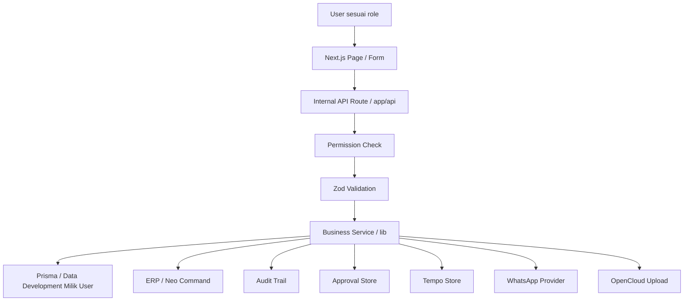
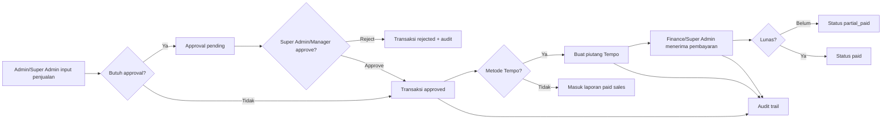
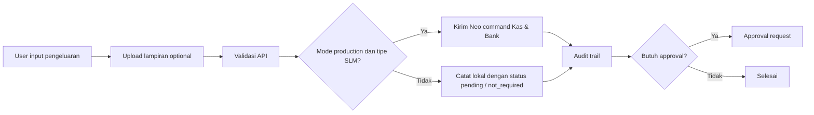
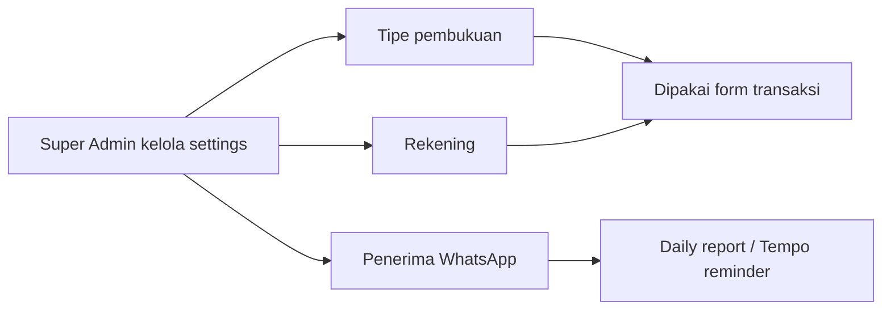

# Dokumentasi Sistem End-to-End Aneka Jaya

Dokumen ini menjelaskan fungsi sistem, alur kerja end-to-end, modul, fitur, data, integrasi, role, dan endpoint utama pada aplikasi internal Aneka Jaya.

Status kesiapan terbaru dan checklist UAT bisnis tersedia di `docs/core-system-readiness-report.md`.

## 1. Ringkasan Sistem

Aneka Jaya Internal App adalah aplikasi operasional internal untuk mencatat dan memantau aktivitas bisnis harian. Sistem ini berfokus pada:

- input penjualan;
- input pengeluaran;
- pengelolaan data barang dan stok;
- approval transaksi;
- pengelolaan piutang Tempo;
- dashboard operasional;
- laporan harian dan laporan finance;
- audit trail;
- integrasi ERP Aneka/Anika;
- integrasi WhatsApp untuk laporan dan reminder;
- upload lampiran melalui abstraksi OpenCloud;
- preview cetak nota dot matrix.

Stack utama:

- Next.js App Router;
- TypeScript;
- Tailwind CSS;
- React Hook Form;
- Zod validation;
- Prisma dan PostgreSQL sebagai fondasi database produksi;
- JSON store untuk data development yang benar-benar diinput pengguna dan migrasi bertahap;
- Vitest untuk test otomatis.

Mode aplikasi tidak menentukan sumber data simulasi. Runtime selalu memakai ERP, database, atau data development yang benar-benar diinput pengguna. Integrasi yang belum dikonfigurasi menghasilkan error atau empty state yang jelas.

## 2. Tujuan dan Fungsi Utama Sistem

Fungsi utama sistem adalah menjadi pusat operasional harian untuk mencatat transaksi, menjaga kontrol akses, memantau status penjualan dan piutang, serta menyediakan jejak audit.

Secara bisnis, sistem membantu:

- Admin mencatat penjualan serta melihat detail dan mencetak riwayat penjualan miliknya sendiri.
- Finance mencatat pengeluaran, pembayaran Tempo, dan melihat laporan finance.
- Manager memeriksa approval dan memantau laporan terbatas.
- Super Admin (nilai internal `OWNER`) memantau dashboard, semua laporan, konfigurasi, audit trail, dan integrasi.
- Sistem mengurangi risiko transaksi tidak tercatat melalui validasi, approval, audit trail, dan pemisahan role.

## 3. Aktor dan Hak Akses

Hak akses dipusatkan di `lib/auth/roles.ts`.

| Role | Fungsi utama | Landing page | Akses dashboard |
| --- | --- | --- | --- |
| Super Admin (`OWNER`) | Akses penuh, konfigurasi, laporan, audit, approval, ERP sync | `/dashboard` | Ya |
| Admin | Input penjualan serta melihat dan mencetak riwayat penjualan miliknya sendiri | `/penjualan/input` | Tidak |
| Finance | Pengeluaran, Tempo, laporan finance | `/tempo` | Tidak |
| Manager | Approval, Tempo view, laporan finance terbatas, audit approval | `/approval` | Tidak |
| Viewer | Tidak memiliki akses operasional default | `/no-access` | Tidak |

Permission penting:

- `penjualan.create`: membuat penjualan serta melihat detail dan mencetak riwayat milik Admin pembuatnya.
- `pengeluaran.create`: membuat pengeluaran.
- `stock.view` dan `stock.create`: melihat dan membuat data barang.
- `approval.view` dan `approval.approve`: melihat dan memutus approval.
- `tempo.view` dan `tempo.mark_paid`: melihat dan membayar Tempo.
- `reports.view` dan `reports.finance_view`: melihat laporan.
- `settings.*`: mengelola pengaturan.
- `audit.view`: melihat audit trail.
- `erp_sync.retry`: melihat atau menjalankan ulang sinkronisasi ERP.

Proteksi halaman dilakukan di `proxy.ts`. API penting juga melakukan pengecekan permission di server route masing-masing.

## 4. Arsitektur Tingkat Tinggi



Lapisan utama:

- `app/`: halaman aplikasi dan route API.
- `components/`: komponen UI, form, layout, dashboard, settings, approval, tempo.
- `lib/`: business logic, API adapter, auth, audit, approval, tempo, WhatsApp, OpenCloud, validation, type.
- `data/`: penyimpanan data development yang dibuat pengguna; tidak berisi seed atau fallback simulasi.
- `prisma/`: schema dan migration database produksi.
- `docs/`: dokumentasi API dan dokumentasi sistem.
- `tests/`: test otomatis.

## 5. Alur End-to-End Utama

### 5.1 Alur Login/Role dan Akses Halaman

1. User masuk ke aplikasi.
2. Jika belum memiliki session login internal, user diarahkan ke `/login`.
3. `/login` menampilkan form email/username dan password.
4. Setelah credential valid, sistem membuat session cookie httpOnly dan membaca role dari Prisma `User`.
5. `proxy.ts`, server page, dan API mengecek permission.
6. Jika role memiliki permission, halaman dibuka.
7. Jika tidak, user diarahkan ke landing page role tersebut atau `/no-access`.

Mode identity:

- `AUTH_PROVIDER=demo`: memakai cookie role internal khusus development teknis.
- `AUTH_PROVIDER=local_credentials`: login operasional utama memakai email/username dan password.
- `AUTH_SESSION_SECRET`: secret server-side untuk menandatangani session cookie.
- `AUTH_PROVIDER=trusted_header`: opsi teknis lama untuk reverse proxy/SSO, bukan jalur utama operasional saat ini.
- `AUTH_ENABLE_DEMO_ROLE_SELECTOR=true`: hanya untuk menampilkan selector role development; jangan aktifkan untuk UAT operasional.
- Pada jalur operasional, role selalu berasal dari user aktif di database, bukan pilihan manual.

### 5.2 Alur Input Penjualan

Halaman:

- `/penjualan/input`

API:

- `POST /api/sales`

File utama:

- `components/forms/PenjualanForm.tsx`
- `lib/validation/penjualanSchema.ts`
- `app/api/sales/route.ts`
- `lib/api/sales.ts`
- `lib/sales/store.ts`
- `lib/approval/store.ts`
- `lib/tempo/store.ts`
- `lib/audit/store.ts`

Alur:

1. User dengan permission `penjualan.create` membuka form penjualan.
2. User mengisi tanggal, tipe pembukuan, customer, metode pembayaran, rekening, barang, quantity, harga, diskon, dan catatan.
3. Frontend mengirim data ke `POST /api/sales`.
4. API mengecek permission `penjualan.create`.
5. API memvalidasi body dengan `penjualanSchema`.
6. Sistem menghitung total dari semua item:
   - `quantity * unitPrice - discount`.
7. Sistem menentukan status approval:
   - Jika user Admin dan approval penjualan aktif, status menjadi `pending_approval`.
   - Selain itu status menjadi `approved`.
8. Pada development, transaksi input pengguna disimpan ke JSON store tanpa data contoh otomatis.
9. Pada production, transaksi dikirim ke ERP melalui Neo command dengan `auto_create_invoice` dan disimpan ke Prisma setelah ERP menerima transaksi.
10. Sistem membuat audit trail.
11. Jika perlu approval, sistem membuat approval request.
12. Jika transaksi approved dan metode pembayaran `Tempo`, sistem membuat piutang Tempo.

Aturan validasi penting:

- Minimal satu barang wajib ada.
- Quantity harus lebih dari 0.
- Harga satuan tidak boleh negatif.
- Cash/TF wajib memilih rekening atau mengisi akun transfer.
- Tempo wajib memiliki tanggal jatuh tempo.
- Tempo wajib memiliki nama customer yang jelas, bukan default `Walk In`.

Output bisnis:

- Cash/TF masuk ke laporan harian paid sales.
- Tempo tidak masuk Grand Total harian sampai dibayar.
- Penjualan Admin dapat tertahan di approval sebelum dianggap final.

### 5.3 Alur Approval Penjualan

Halaman:

- `/approval`
- `/approval/[id]`

API:

- `POST /api/approval/[id]`

File utama:

- `components/approval/ApprovalActionForm.tsx`
- `lib/approval/store.ts`
- `lib/approval/validation.ts`

Alur:

1. Admin membuat transaksi yang membutuhkan approval.
2. Sistem membuat `ApprovalRequest` dengan status `pending_approval`.
3. Super Admin atau Manager membuka daftar approval.
4. Approver memilih approve atau reject.
5. Sistem memvalidasi transisi status.
6. Sistem menolak approval oleh pembuat data sendiri, kecuali role internal `OWNER` (Super Admin).
7. Jika approved:
   - status approval berubah menjadi `approved`;
   - status penjualan ikut diperbarui;
   - jika penjualan menggunakan Tempo, piutang Tempo dibuat.
8. Jika rejected:
   - status approval berubah menjadi `rejected`;
   - alasan reject wajib diisi;
   - status penjualan ikut menjadi rejected.
9. Semua perubahan dicatat ke audit trail.

### 5.4 Alur Tempo atau Piutang Penjualan

Halaman:

- `/tempo`
- `/tempo/[id]`

API:

- `POST /api/tempo/[id]/pay`
- `GET /api/print/tempo/[id]`

File utama:

- `components/tempo/TempoPayForm.tsx`
- `lib/tempo/store.ts`
- `lib/tempo/summary.ts`
- `lib/print/dotMatrix.ts`

Alur pembuatan Tempo:

1. User membuat penjualan dengan metode pembayaran `Tempo`.
2. Jika transaksi langsung approved, sistem langsung membuat `TempoReceivable`.
3. Jika transaksi pending approval, Tempo baru dibuat setelah approval disetujui.
4. Tempo menyimpan customer, nilai awal, nilai dibayar, sisa piutang, tanggal transaksi, jatuh tempo, dan status.

Status Tempo:

- `open`: belum ada pembayaran dan belum overdue.
- `partial_paid`: sudah dibayar sebagian.
- `paid`: lunas.
- `overdue`: jatuh tempo sudah lewat dan belum lunas.
- `cancelled`: dibatalkan.
- `written_off`: dihapus bukukan.

Alur pembayaran Tempo:

1. Finance atau Super Admin membuka detail Tempo.
2. User mengisi tanggal bayar, nominal, metode pembayaran, rekening, lampiran, dan catatan.
3. Sistem mengecek permission `tempo.mark_paid`.
4. Nominal harus lebih dari 0 dan tidak boleh melebihi sisa piutang.
5. Sistem menambah record pembayaran.
6. Sistem memperbarui paid amount, remaining amount, dan status.
7. Jika sisa 0, status menjadi `paid`; jika masih tersisa, status menjadi `partial_paid`.
8. Sistem mencatat audit trail.

### 5.5 Alur Input Pengeluaran

Halaman:

- `/pengeluaran/input`

API:

- `POST /api/expenses`
- `POST /api/upload`

File utama:

- `components/forms/PengeluaranForm.tsx`
- `lib/validation/pengeluaranSchema.ts`
- `lib/api/expenses.ts`
- `lib/opencloud/storage.ts`

Alur:

1. User dengan permission `pengeluaran.create` membuka form pengeluaran.
2. User mengisi tanggal, tipe, rekening, COA, kategori, vendor/penerima, deskripsi, nominal, metode pembayaran, lampiran, dan catatan.
3. Jika ada lampiran, file dikirim ke `POST /api/upload`.
4. Upload divalidasi:
   - PDF, JPG, JPEG, PNG, atau WEBP;
   - ukuran maksimal default 5 MB.
5. Data pengeluaran dikirim ke `POST /api/expenses`.
6. API mengecek permission dan validasi Zod.
7. Sistem menentukan status approval untuk Admin bila approval pengeluaran aktif.
8. Pada development, data input pengguna dicatat ke audit trail lokal dan approval request dibuat bila diperlukan; status sinkronisasi tidak pernah dipalsukan.
9. Mode production:
   - untuk tipe selain `SLM`, ERP sync dianggap `not_required`;
   - untuk tipe `SLM`, sistem mengirim Neo command untuk membuat transaksi Kas & Bank keluar dengan COA terkait.
10. Sistem mencatat audit trail.

### 5.6 Status Pembelian

Modul Pembelian tidak termasuk versi operasional aktif. Menu dan permission Pembelian dinonaktifkan, sedangkan akses langsung menghasilkan 404 sampai alur bisnis serta kontrak ERP final tersedia.

### 5.7 Alur Data Barang dan Stok

Halaman:

- `/barang`
- `/stok-barang`
- `/barang/input`
- `/barang/[id]/edit`

API:

- `GET /api/products`
- `POST /api/products`
- `GET /api/products/[id]`
- `PUT /api/products/[id]`
- `GET /api/stocks`

File utama:

- `components/forms/BarangForm.tsx`
- `components/products/ProductList.tsx`
- `components/stocks/StockList.tsx`
- `lib/validation/barangSchema.ts`
- `lib/api/products.ts`
- `lib/api/stocks.ts`
- `lib/stockAlerts/store.ts`

Alur lihat barang:

1. User dengan akses stock membuka daftar barang.
2. Sistem memanggil `GET /api/products`.
3. Sistem selalu mengambil data dari ERP endpoint `/products`.
4. Jika ERP belum dikonfigurasi atau gagal, halaman menampilkan error dan tidak mengganti hasil dengan data contoh.
5. Data dipetakan menjadi format produk internal.

Alur tambah barang:

1. User mengisi kode, nama, kategori, satuan, harga jual, harga modal, brand, stok awal, minimum stock, gudang, rak, status aktif, dan catatan.
2. API mengecek permission `stock.create`.
3. Data divalidasi dengan `barangSchema`.
4. Sistem mengirim Neo command `import_products`; jika ERP belum tersedia, operasi ditolak dengan pesan konfigurasi.
6. Sistem mengecek minimum stock alert.
7. Sistem mencatat audit trail.

Alur edit barang:

1. User membuka detail edit barang.
2. Sistem mengambil data barang.
3. User memperbarui data.
4. Sistem memakai `PUT /products/{product}` dan tidak menyediakan fallback data lokal palsu.
6. Sistem menjaga referensi kategori, satuan, dan merk dari ERP. Jika referensi ERP tidak lengkap, update dihentikan dengan pesan aman.
7. Sistem mencatat audit trail.

### 5.8 Alur Dashboard

Halaman:

- `/dashboard`

Role:

- Super Admin.

Fitur:

- KPI penjualan bulan ini.
- KPI penjualan hari ini.
- KPI Tempo terbuka.
- Jumlah produk ERP.
- Grafik performa dari penjualan approved dan audit pengeluaran nyata selama enam bulan.
- Grafik kategori dari item penjualan dan kategori produk ERP.
- Aktivitas terbaru dari audit trail.
- Status koneksi ERP.
- Status OpenCloud.
- Shortcut input penjualan dan pengeluaran.

Data dashboard:

- Mengambil penjualan dari `listSalesRecords()`.
- Hanya penjualan approved yang dihitung.
- Tempo terbuka dihitung dari `listTempoReceivables()`.
- Produk dihitung dari `listProducts()`.
- Jika data belum tersedia, grafik dan aktivitas menampilkan empty state.

### 5.9 Alur Laporan

Halaman:

- `/reports`
- `/reports/finance`

File utama:

- `lib/whatsapp/reportFormatter.ts`
- `lib/tempo/summary.ts`

Fungsi laporan:

- Ringkasan paid sales harian.
- Pengelompokan Cash dan TF per tipe.
- Grand Total harian yang mengecualikan Tempo.
- Daftar Tempo terbuka.
- Laporan finance untuk Finance, Manager, dan Super Admin.

Aturan penting:

- Penjualan Tempo tidak masuk Grand Total sampai ada pembayaran.
- Laporan harian hanya menghitung Cash/TF dari transaksi approved.
- Tempo yang statusnya paid, cancelled, atau written_off tidak dihitung sebagai Tempo terbuka.

### 5.10 Alur WhatsApp Report dan Reminder

Settings:

- `/settings/whatsapp`

Job routes:

- `POST /api/jobs/send-daily-report`
- `POST /api/jobs/send-tempo-reminder`
- `POST /api/whatsapp/test`

File utama:

- `lib/whatsapp/reportScheduler.ts`
- `lib/whatsapp/reportFormatter.ts`
- `lib/whatsapp/whatsappClient.ts`
- `lib/whatsapp/providers/*`

Provider:

- `meta_cloud_api`
- `third_party`

Provider yang tidak dikonfigurasi ditampilkan sebagai tidak tersedia dan pengiriman ditolak.

Alur daily report:

1. Cron memanggil `POST /api/jobs/send-daily-report`.
2. Route memvalidasi `CRON_SECRET`.
3. Sistem membuat isi laporan harian.
4. Sistem mencari penerima WhatsApp aktif yang menerima daily report.
5. Sistem mengirim pesan melalui provider terpilih.
6. Sistem mencatat log pengiriman.

Alur tempo reminder:

1. Cron memanggil `POST /api/jobs/send-tempo-reminder`.
2. Sistem mencari Tempo yang jatuh tempo dalam 14 hari atau overdue.
3. Jika tidak ada data relevan, job tidak mengirim pesan.
4. Jika ada, pesan dikirim ke penerima aktif yang menerima tempo reminder.

### 5.11 Alur Stock Alert

Job route:

- `POST /api/jobs/check-stock-alert`

File utama:

- `lib/stockAlerts/store.ts`
- `lib/stockAlerts/scheduler.ts`

Alur:

1. Cron memanggil endpoint stock alert.
2. Sistem memvalidasi secret cron.
3. Sistem memeriksa produk terhadap minimum stock.
4. Jika stok berada di bawah minimum, sistem membuat log alert.
5. Alert dapat dikembangkan untuk dikirim melalui WhatsApp atau channel lain.

### 5.12 Alur ERP Sync dan Retry

Halaman:

- `/erp-sync`

API:

- `POST /api/jobs/retry-erp-sync`

Role:

- Super Admin.

Fungsi:

- Memantau dan menyiapkan retry sinkronisasi ERP.
- Endpoint job dilindungi `CRON_SECRET`.
- Permission halaman memakai `erp_sync.retry`.

### 5.13 Alur Audit Trail

Halaman:

- `/audit-trail`

File utama:

- `lib/audit/store.ts`
- `data/audit-trail.json`

Fungsi:

- Mencatat perubahan penting pada transaksi, approval, Tempo, produk, pengaturan, WhatsApp, stock alert, dan ERP sync.
- Menyimpan actor, role snapshot, waktu, entity, action, before value, after value, IP, user agent, dan alasan.

Filter role:

- Super Admin melihat audit secara penuh.
- Manager melihat audit terkait approval.
- Finance melihat audit terkait Tempo dan pembayaran.

### 5.14 Alur Settings

Halaman:

- `/settings`
- `/settings/tipe`
- `/settings/rekening`
- `/settings/whatsapp`

API:

- `GET/POST/PUT /api/tipe`
- `GET/POST/PUT /api/rekening`
- `POST /api/whatsapp/test`

Fitur:

- Kelola tipe pembukuan.
- Kelola rekening pembayaran.
- Kelola penerima WhatsApp.
- Test pengiriman WhatsApp.
- Role selector hanya untuk development teknis eksplisit.

Tidak ada tipe atau rekening default. Super Admin wajib mengisi master data sebelum transaksi dibuat.

## 6. Modul dan Fitur

| Modul | Halaman/API | Fitur utama | Role utama |
| --- | --- | --- | --- |
| Dashboard | `/dashboard` | KPI, chart data nyata, status koneksi, ringkasan Tempo | Super Admin |
| Penjualan | `/penjualan/input`, `/api/sales` | Input multi barang, Cash/TF/Tempo/Other, hitung total, ERP invoice | Super Admin, Admin |
| Pengeluaran | `/pengeluaran/input`, `/api/expenses` | Input biaya, COA, rekening, upload lampiran, ERP Kas & Bank | Super Admin, Admin, Finance |
| Barang | `/barang`, `/barang/input`, `/barang/[id]/edit` | List, tambah, edit produk, stok awal, minimum stock | Super Admin, Admin |
| Stok Barang | `/stok-barang`, `/api/stocks` | Lihat stok ERP; error state bila integrasi gagal | Super Admin, Admin |
| Approval | `/approval`, `/approval/[id]` | Approve/reject transaksi | Super Admin, Manager |
| Tempo | `/tempo`, `/tempo/[id]` | Piutang, payment, partial paid, overdue | Super Admin, Finance, Manager view |
| Reports | `/reports`, `/reports/finance` | Laporan harian dan finance | Super Admin, Finance, Manager terbatas |
| Audit Trail | `/audit-trail` | Jejak perubahan data | Super Admin, Manager/Finance terbatas |
| ERP Sync | `/erp-sync` | Status dan retry sinkronisasi | Super Admin |
| Settings | `/settings/*` | Tipe, rekening, WhatsApp, user dan role database | Super Admin |
| Print | `/api/print/*` | Preview teks fixed-width dot matrix | Role sesuai akses transaksi |
| API Docs | `/api/docs`, `/api/docs/openapi.json` | Dokumentasi API formal | Super Admin |

## 7. Data dan Penyimpanan

### 7.1 JSON Store

Mode development memakai file JSON di folder `data/` untuk data yang benar-benar dibuat pengguna. File dibuat saat ada penulisan dan tidak diisi fixture otomatis. JSON store bukan source of truth transaksi finansial production.

File penting:

- `audit-trail.json`
- `sales-records.json`
- `approval-requests.json`
- `tempo-receivables.json`
- `tempo-payments.json`
- `whatsapp-recipients.json`
- `whatsapp-message-logs.json`
- `stock-alert-logs.json`
- `bookkeeping-types.json`
- `rekening-accounts.json`

Catatan deployment:

- Folder `data/` hanya perlu dipertahankan untuk development, legacy import, dan modul pendukung yang belum dipindahkan.
- Data finansial production harus memakai PostgreSQL/Prisma; hindari operasi multi-file JSON untuk transaksi production.
- Tanpa volume persisten, data JSON development/legacy dapat hilang saat container restart.

### 7.2 Prisma/PostgreSQL

Fondasi database produksi ada di `prisma/schema.prisma`.

Model utama:

- `AuditLog`
- `ApprovalRequest`
- `TempoReceivable`
- `TempoPayment`
- `SalesRecord`
- `SalesRecordItem`
- `BookkeepingType`
- `RekeningAccount`
- `RekeningAccountBookkeepingType`
- `WhatsAppRecipient`
- `WhatsAppMessageLog`
- `StockAlertLog`

Boundary normalisasi:

- `SalesRecordItem` menyimpan item penjualan secara relational agar bisa di-query dan divalidasi tanpa membaca JSON blob.
- `BookkeepingType`, `RekeningAccount`, dan `RekeningAccountBookkeepingType` menjadi master data relational production.
- Field snapshot transaksi seperti `tipeCodeSnapshot`, `tipeNameSnapshot`, dan `rekeningNameSnapshot` tetap disimpan agar laporan historis tidak berubah saat master data diedit.
- `AuditLog.beforeValue` dan `AuditLog.afterValue` tetap JSON karena fungsinya adalah snapshot audit.

Migration awal:

- `prisma/migrations/20260627000000_initial_production_readiness/migration.sql`

Script pendukung:

- `scripts/migrate-json-to-prisma.mjs`
- `scripts/verify-prisma-db.mjs`

## 8. Integrasi Eksternal

### 8.1 ERP Aneka/Anika

Environment:

- `NEXT_PUBLIC_APP_MODE=production`
- `ANIKA_ERP_API_BASE_URL`
- `ANIKA_ERP_API_TOKEN`

Endpoint/adaptor:

- `GET /products`
- `PUT /products/{product}`
- `GET /stocks`
- `GET /invoices`
- `POST /neo/commands`

Transaksi:

- Penjualan dikirim sebagai Neo command `create_sales` dengan `auto_create_invoice`.
- Barang dikirim sebagai Neo command `import_products`.
- Pengeluaran tipe `SLM` dikirim sebagai Neo command transaksi Kas & Bank keluar.

Keamanan:

- Token ERP hanya dibaca server-side.
- Browser tidak memanggil ERP langsung.

### 8.2 OpenCloud

Environment:

- `OPENCLOUD_API_BASE_URL`
- `OPENCLOUD_PROJECT_ID`
- `OPENCLOUD_API_KEY`
- `OPENCLOUD_STORAGE_BUCKET`
- `OPENCLOUD_MAX_FILE_SIZE_BYTES`

Fungsi:

- Upload bukti pengeluaran atau pembayaran.
- Upload ditolak bila OpenCloud belum dikonfigurasi atau mapping API belum lengkap; sistem tidak menghasilkan URL palsu.

### 8.3 WhatsApp

Environment:

- `WHATSAPP_PROVIDER`
- `WHATSAPP_CLOUD_API_TOKEN`
- `WHATSAPP_PHONE_NUMBER_ID`
- `WHATSAPP_THIRD_PARTY_ENDPOINT`
- `WHATSAPP_THIRD_PARTY_TOKEN`

Provider yang didukung:

- Meta Cloud API;
- third-party provider.

Jika provider atau recipient belum dikonfigurasi, pengiriman ditolak dan tidak dibuat penerima default.

Fungsi:

- test message;
- daily report;
- tempo reminder;
- message log.

### 8.4 Cron Job

Endpoint:

- `POST /api/jobs/send-daily-report`
- `POST /api/jobs/send-tempo-reminder`
- `POST /api/jobs/check-stock-alert`
- `POST /api/jobs/retry-erp-sync`

Proteksi:

- Header `x-cron-secret: CRON_SECRET`; atau
- query `?secret=...`.

## 9. API Internal Utama

| Method | Endpoint | Fungsi |
| --- | --- | --- |
| `GET` | `/api/health` | Health check |
| `POST` | `/api/sales` | Membuat penjualan |
| `POST` | `/api/expenses` | Membuat pengeluaran |
| `GET` | `/api/products` | List produk |
| `POST` | `/api/products` | Tambah produk |
| `GET` | `/api/products/[id]` | Detail produk |
| `PUT` | `/api/products/[id]` | Update produk |
| `GET` | `/api/stocks` | List stok |
| `POST` | `/api/approval/[id]` | Approve/reject approval |
| `POST` | `/api/tempo/[id]/pay` | Bayar Tempo |
| `POST` | `/api/upload` | Upload lampiran |
| `GET/POST/PUT` | `/api/tipe` | Kelola tipe |
| `GET/POST/PUT` | `/api/rekening` | Kelola rekening |
| `POST` | `/api/whatsapp/test` | Test WhatsApp |
| `GET` | `/api/docs` | Halaman API docs |
| `GET` | `/api/docs/openapi.json` | OpenAPI JSON |
| `GET` | `/api/print/sales/[id]` | Preview nota penjualan |
| `GET` | `/api/print/tempo/[id]` | Preview bukti bayar Tempo |

Response umum:

- Berhasil: `{ success: true, data }`
- Gagal: `{ success: false, message, code, details }`

## 10. Validasi dan Kontrol Kualitas Data

Validasi memakai Zod di folder `lib/validation`.

Validasi penjualan:

- tanggal valid;
- tipe wajib;
- metode pembayaran wajib;
- item minimal 1;
- quantity positif;
- harga tidak negatif;
- rekening wajib untuk Cash/TF;
- customer dan due date wajib untuk Tempo.

Validasi pengeluaran:

- tanggal valid;
- tipe, rekening, COA wajib;
- kategori, vendor, deskripsi wajib;
- nominal positif;
- lampiran harus URL valid bila diisi.

Validasi barang:

- kode, nama, kategori, satuan wajib;
- harga jual dan modal tidak negatif;
- stok awal dan minimum stock tidak negatif;
- gudang default `Toko`;
- status aktif default true.

## 11. Cetak Dot Matrix

Endpoint:

- `GET /api/print/sales/[id]`
- `GET /api/print/tempo/[id]`

Format:

- `text/plain`;
- fixed-width 80 kolom;
- cocok untuk preview atau browser print dengan font monospace.

Batasan:

- Belum mengirim raw command langsung ke printer fisik.
- Integrasi direct print berikutnya perlu memilih pendekatan browser print, local print agent, atau server-side raw printer.

## 12. Keamanan

Prinsip keamanan:

- Token ERP, OpenCloud, dan WhatsApp hanya server-side.
- Jangan memakai prefix `NEXT_PUBLIC_` untuk secret.
- API bisnis memeriksa permission server-side.
- Halaman diproteksi melalui `proxy.ts`.
- Cron job dilindungi `CRON_SECRET`.
- Error ke user tidak berisi stack trace atau token.
- Trusted header auth hanya aman jika berada di belakang reverse proxy/SSO yang terpercaya dan `AUTH_TRUSTED_HEADER_SECRET` diisi.
- User management memakai Prisma `User`; role database mengalahkan role header dan perubahan user dicatat di audit trail.

## 13. Deployment dan Operasional

Perintah local:

```bash
npm install
npm run dev
```

Build:

```bash
npm run build
npm run start
```

Database production-like dengan Docker:

```bash
docker compose up -d postgres
docker compose --profile tools run --rm db-migrate
docker compose --profile tools run --rm db-seed-owner
docker compose --profile tools run --rm db-import
docker compose --profile tools run --rm db-verify
```

Seeder production-like hanya membuat Owner pertama. Master data tipe dan rekening tidak diseed; Super Admin harus mengisinya dengan data bisnis nyata. Setelah itu jalankan:

```bash
npm run app:check-core-readiness
```

Checklist sebelum deploy:

- `.env.local` atau environment platform sudah lengkap.
- `NEXT_PUBLIC_APP_MODE` sesuai target.
- `ANIKA_ERP_API_TOKEN` tidak terekspos ke client.
- `CRON_SECRET` diganti dari default.
- `AUTH_PROVIDER=local_credentials` dan `AUTH_SESSION_SECRET` dikonfigurasi untuk login internal.
- Akun Super Admin pertama dibuat di tabel `User` dengan `externalId`/email dan password awal.
- Tipe pembukuan, rekening, dan relasi rekening-tipe dibuat manual dari Settings.
- `npm run app:check-core-readiness` lulus sebelum UAT transaksi.
- `data/` menjadi persistent volume jika JSON store masih dipakai.
- WhatsApp provider dipilih sesuai kebutuhan.
- OpenCloud dikonfigurasi jika upload production diperlukan.

Verifikasi otomatis:

```bash
APP_BASE_URL=http://localhost:3000 \
SMOKE_LOGIN_IDENTIFIER=... \
SMOKE_LOGIN_PASSWORD=... \
npm run deploy:check-env
npm run deploy:smoke-auth
npm run lint
npm test
npm run build
npx prisma format
npx prisma generate
```

Runbook production-like lengkap: `docs/production-like-verification-runbook.md`.

## 14. Batasan Saat Ini dan Catatan Pengembangan

Batasan yang terlihat dari kode saat ini:

- Flow production untuk Penjualan, Approval, Tempo, Audit utama, item penjualan, Tipe, dan Rekening memakai Prisma/PostgreSQL.
- JSON store masih dipakai untuk data development milik pengguna, legacy import, dan beberapa modul pendukung yang belum final.
- Upload OpenCloud production masih menunggu mapping API final.
- Pengeluaran production memakai Neo command karena endpoint finance langsung belum tersedia di dokumentasi ERP yang dipakai.
- Direct printer dot matrix belum tersedia, baru preview teks.
- Pembelian ditunda dan tidak ditampilkan sebagai modul aktif sampai kontrak bisnis dan ERP final tersedia.

Rekomendasi pengembangan berikutnya:

- Lanjutkan migrasi bertahap modul pendukung yang masih JSON-only ke Prisma.
- Tambahkan query/reporting yang memanfaatkan tabel normalized seperti `SalesRecordItem`.
- Tambahkan status dan retry queue ERP yang lebih eksplisit.
- Finalisasi integrasi upload OpenCloud.
- Finalisasi direct print bila printer fisik sudah dipilih.
- Tambahkan test E2E untuk alur penjualan, approval, Tempo, dan laporan.

## 15. Ringkasan Alur Bisnis Lengkap






